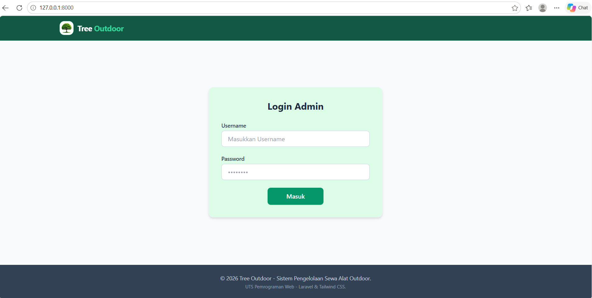
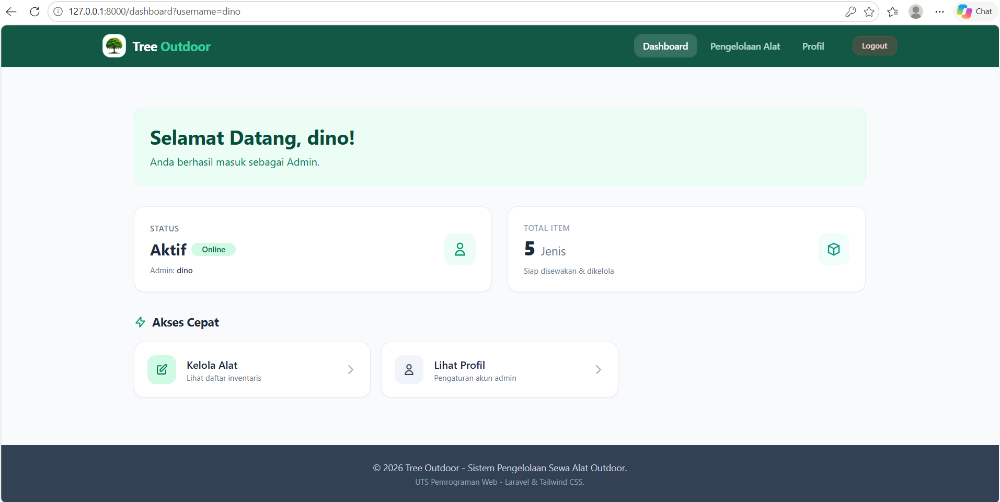
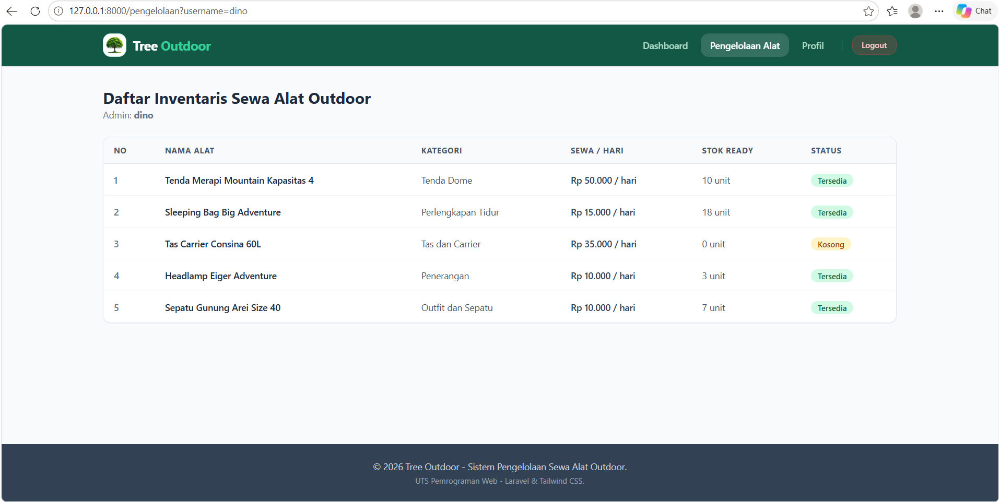
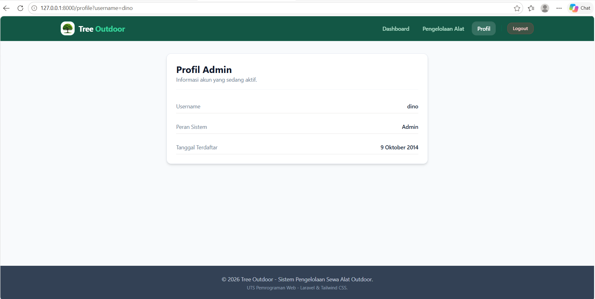

# Tree Outdoor - Aplikasi Sewa Alat Outdoor

Aplikasi berbasis web untuk pengelolaan sewa peralatan outdoor(camping, hiking, dan adventure). Jadi disana bisa menampilkan alat apa saja yang ada dan kita juga akan tahu ketersediaanya. Proyek ini dibuat menggunakan Laravel 12 dengan menerapkan arsitektur MVC (Model-View-Controller).

# Teknologi yang Digunakan

* Framework: Laravel 12.71.0
* PHP 8.2.12
* Menggunakan Tailwind CSS (via CDN)

# Fitur Utama Aplikasi

1. Login: pengguna memasukkan username dan password dimana username dan password tersebut tidak tersimpan dalam database.
2. Dashboard: Menampilkan keterangan bahwa pengguna berhasil masuk sebgai admin, dan menampilakan jumlah jenis alat yang siap di sewakan dan di kelola, terdapat navbar dan akses cepat untuk berpindah menu.
3. Pengelolaan: menampilkan tabel untuk daftar alat yang ada, baik itu di stok yang masih tersedia ataupun yang kosong.
4. Profil: menampilkan nformasi detail identitas dan hak akses akun yang sedang aktif.

# Tampilan Aplikasi Website

1. Halaman Login

Pintu masuk sistem sewa dengan input username dan password.

2. Halaman Dashboard Admin

Menampilkan sapaan kepada pengguna aktif dilengkapi dengan kartu status dan informasi jumlah jenis alat yang siap di sewakan serta terdapat akses cepat untuk beralih ke pengelolaan dan profile.

3. Halaman Pengelolaan Alat

Tabel lengkap list alat outdoor beserta kategori, harga sewa, jumlah stok, dan status ketersediaan.

4. Halaman Profil Admin

Informasi detail akun admin.
